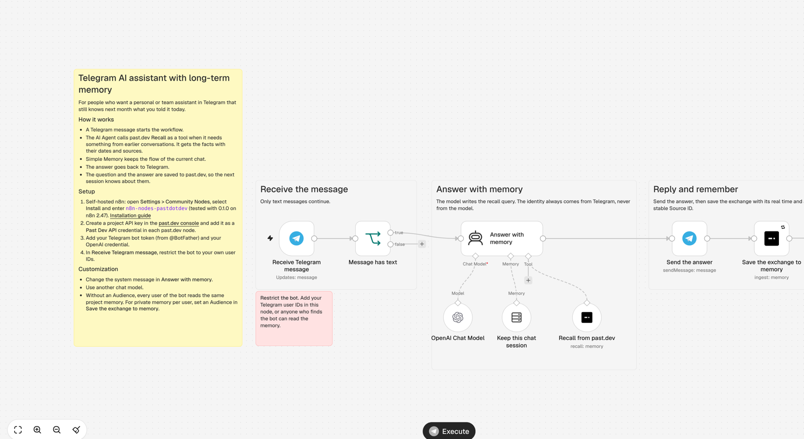
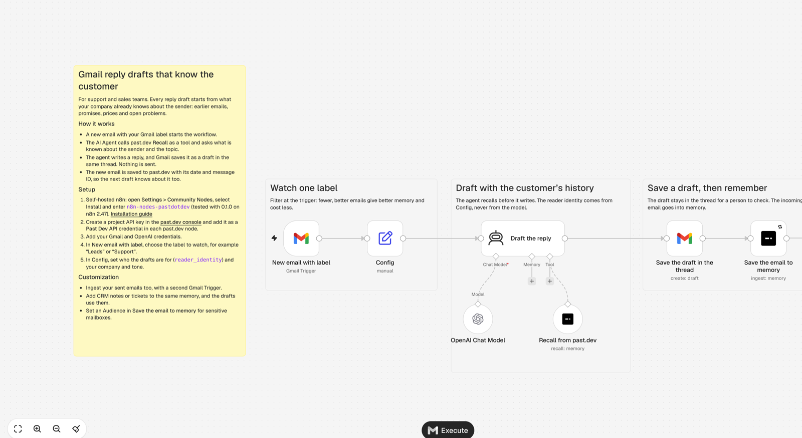
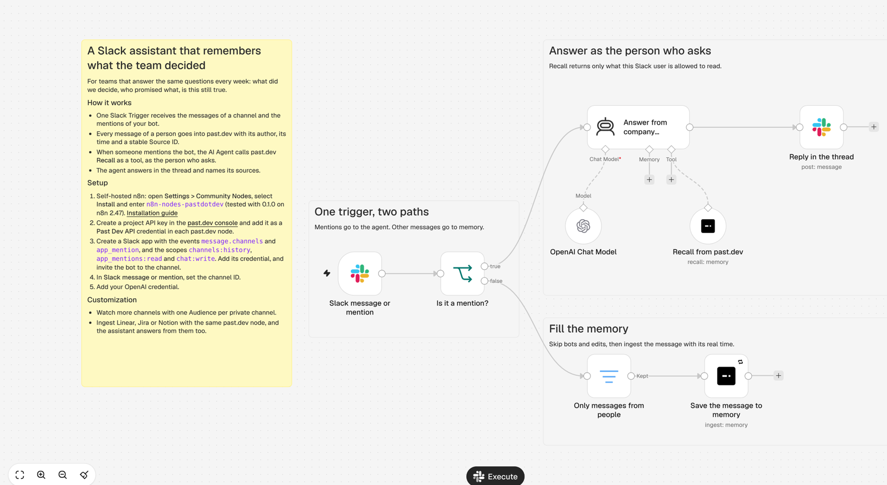
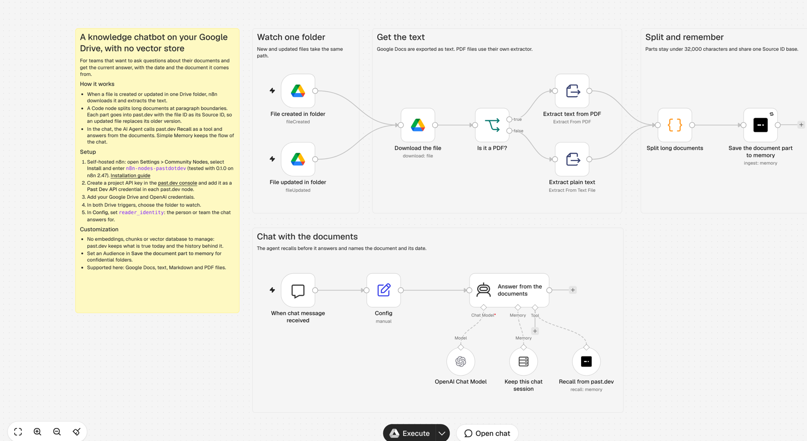
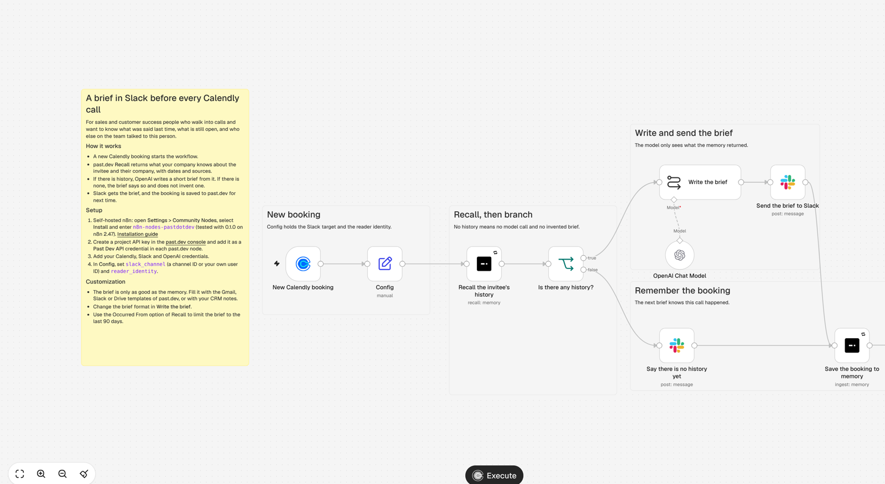

# Workflow templates

Five n8n workflow templates for the node `n8n-nodes-pastdotdev`. Each one fills a past.dev memory from a tool you already use, or lets an AI Agent recall from it, or both.

| Template | Use case | Also needs |
| --- | --- | --- |
| [Run a Telegram AI assistant with long-term memory using past.dev and OpenAI](telegram-assistant-with-long-term-memory.json) | A personal or team assistant in Telegram that recalls earlier conversations before it answers, and saves each exchange. | Telegram, OpenAI |
| [Draft Gmail replies with full customer history using past.dev and OpenAI](gmail-reply-drafts-with-customer-history.json) | A new email with your label gets a reply draft in the same thread, written from what your company knows about the sender. Nothing is sent. | Gmail, OpenAI |
| [Answer team questions in Slack from company memory with past.dev and OpenAI](slack-assistant-with-company-memory.json) | Messages of a Slack channel go into memory. When someone mentions the bot, it answers in the thread from that memory, as the person who asks. | Slack, OpenAI |
| [Chat with your Google Drive documents using past.dev memory and OpenAI](google-drive-knowledge-chatbot.json) | Files of one Drive folder go into memory, split at paragraph boundaries. A chat answers from them with the document and its date. No vector store. | Google Drive, OpenAI |
| [Send Slack briefs before Calendly calls with past.dev memory and OpenAI](calendly-call-briefs-in-slack.json) | A new Calendly booking starts a recall on the invitee. Slack gets a short brief, or a note that there is no history yet. | Calendly, Slack, OpenAI |

## Use a template

1. On a self-hosted n8n, open **Settings > Community Nodes**, select **Install**, and enter `n8n-nodes-pastdotdev`.
2. Create a workflow, and select **Import from File** (or paste the file contents into the canvas).
3. Select your **Past Dev API** credential in each past dev node, and your other credentials in the other nodes.
4. Read the yellow note in the workflow. It lists the values to set, for example the channel, the folder or the label.

## Rules that every template follows

- The identity comes from the trigger or from the **Config** node. The model never chooses it.
- Each ingest has a stable Source ID and the real time of the item, so a second ingest of the same item makes a new revision and not a duplicate.
- Without an Audience, every identity of the project can read a data point. Set an Audience in the ingest node for private data.

## Tested

Each file imports without a node issue on n8n 2.47.3 with `n8n-nodes-pastdotdev` 0.1.0. Run a template with your own accounts before you use it in production.

## Preview

### Run a Telegram AI assistant with long-term memory using past.dev and OpenAI

### Draft Gmail replies with full customer history using past.dev and OpenAI

### Answer team questions in Slack from company memory with past.dev and OpenAI

### Chat with your Google Drive documents using past.dev memory and OpenAI

### Send Slack briefs before Calendly calls with past.dev memory and OpenAI

